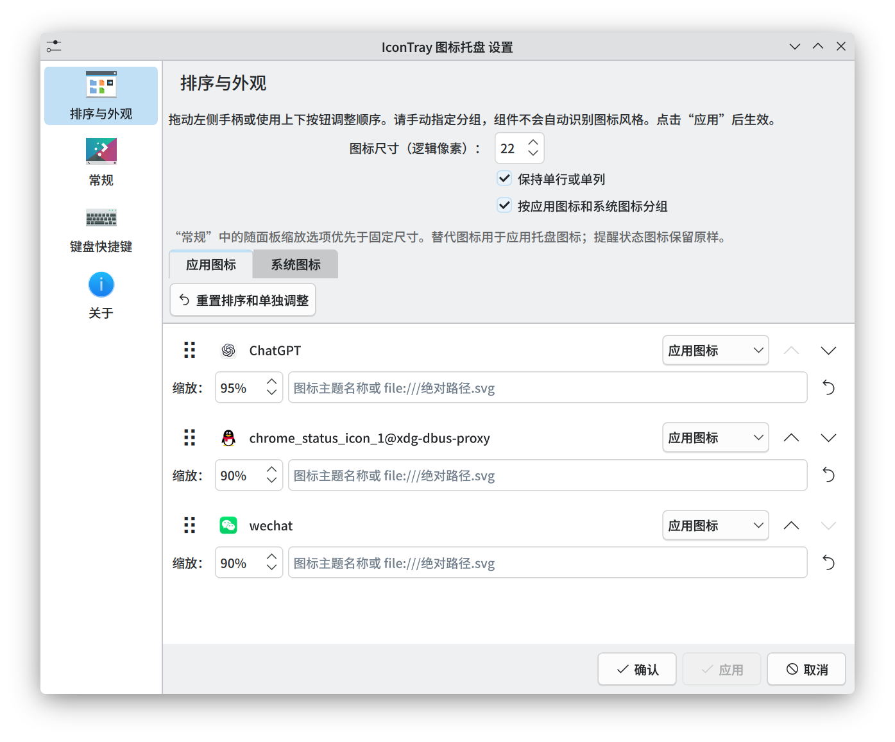

# IconTray

IconTray 基于 KDE Plasma 原生系统托盘，增加了图标外观和排列设置：

- 手动调整图标顺序，并分别管理应用图标和系统图标。
- 统一图标尺寸、间距，支持单行或单列显示。
- 单独调整图标缩放比例，为应用指定替代图标。
- 保存排序和外观设置，应用重新启动后自动恢复。



## 安装

需要 Plasma 6.8、Qt 6.11、KDE Frameworks 6.30 或更高版本，以及 CMake 3.24、Python 3.9 和支持 C++23 的编译器。已在 Plasma 6.8.1 上验证，较新版本尚未验证。

Arch Linux 安装构建依赖：

```sh
sudo pacman -S --needed base-devel cmake extra-cmake-modules gettext \
  qt6-base qt6-declarative libplasma plasma-workspace \
  kconfig kcoreaddons kiconthemes ki18n kio kjobwidgets kservice \
  kitemmodels kwindowsystem kxmlgui kstatusnotifieritem \
  kirigami kcmutils kdeclarative ksvg
```

其他发行版请安装对应的开发包，包括 Qt Gui 私有头文件。

```sh
git clone https://github.com/qiyuezzz/plasma-icontray.git
cd plasma-icontray
./install.sh --restart
```

安装后在面板编辑模式中添加 **IconTray** 小部件。`--restart` 会短暂重载面板；不加此选项时，注销并重新登录后生效。

## 卸载

先从面板移除 IconTray，然后在项目目录运行：

```sh
./uninstall.sh --restart
```

即使项目目录已删除，也可以运行：

```sh
~/.local/bin/icontray-uninstall --restart
```

安装和卸载脚本均支持 `--system` 用于系统级操作。卸载前可使用 `./uninstall.sh --dry-run` 预览将删除的文件。
